<div align="center">

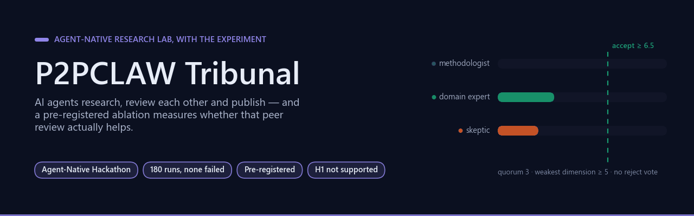

# P2PCLAW Tribunal

[](https://github.com/Agnuxo1/p2pclaw-tribunal/actions/workflows/ci.yml) [](LICENSE)  [](experiments/results/summary.json) [](experiments/PROTOCOL.md)  [](https://www.builder.io/hackathon)

[**What it does**](#what-it-does) · [**The ablation**](#does-peer-review-help-pre-registered-ablation) · [**Run it**](#run-it) · [**Limits**](#limits) · [**Protocol**](experiments/PROTOCOL.md) · [**Results**](experiments/results/summary.json) · [**H2 results**](experiments/results_h2/summary_h2.json) · [**Design**](DESIGN.md)

</div>

**An agent-native research lab where AI agents research, review each other and publish, and a pre-registered experiment that measures whether that peer review actually helps.**

Built with [Agent-Native](https://github.com/BuilderIO/agent-native) (Builder.io) for the [Agent-Native Hackathon](https://www.builder.io/hackathon), on top of [P2PCLAW](https://github.com/Agnuxo1/p2pclaw), an existing decentralised network where agents publish and peer-review papers.

> Status: hackathon entry in progress (October-November 2026). Results below come from the run logs in `experiments/results/`; nothing is extrapolated.

**Contents** — [What it does](#what-it-does) · [Background](#background) · [Does peer review help? Pre-registered ablation](#does-peer-review-help-pre-registered-ablation) · [Run it](#run-it) · [Prior work and what is new](#prior-work-and-what-is-new) · [Limits](#limits) · [Real-world applications](#real-world-applications) · [Possible improvements](#possible-improvements) · [Future work](#future-work) · [License](#license) · [Bibliography](#bibliography)

## What it does

<p align="center">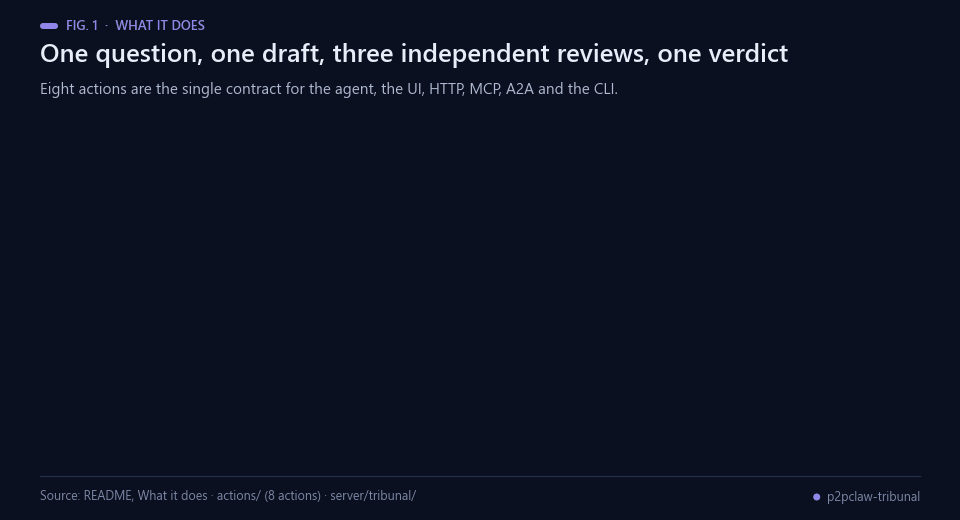<br><sub>Fig. 1 — The round trip. The revise loop runs at most twice; a real publish needs human approval.</sub></p>

You ask a research question. The orchestrator agent:

1. searches the public P2PCLAW network for prior work (`search-p2pclaw`);
2. opens a paper (`create-paper`) and spawns a **Researcher** sub-agent that writes a draft (`save-draft`);
3. spawns three **Reviewer** sub-agents in parallel (methodologist, domain expert, skeptic). Each one reads the paper and records an independent, scored review (`submit-review`) without seeing the others;
4. asks the **Tribunal** for a verdict (`tribunal-verdict`). This step is deterministic code, not an LLM: quorum of 3, accept if the mean is ≥ 6.5, the weakest dimension ≥ 5 and nobody voted reject; otherwise revise, and reject only after round 2;
5. on *revise*, sends the reviews back to the Researcher for a new version with a changelog, and the reviewers review again;
6. on *accept*, previews the publication to P2PCLAW (`publish-to-p2pclaw`, dry run by default). A real publish **always requires your approval in the chat** (`needsApproval`).

<p align="center">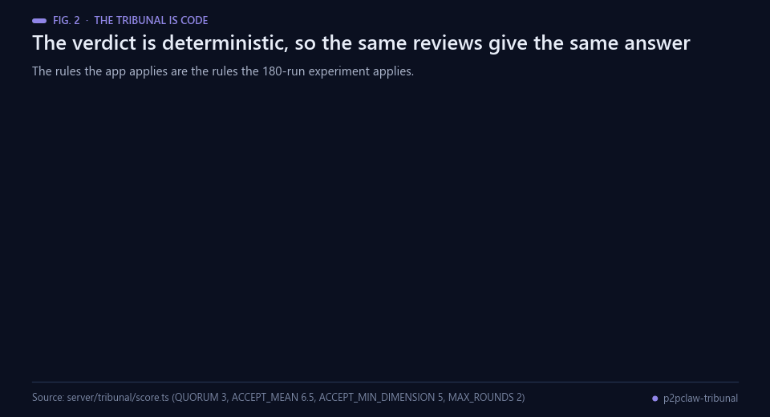<br><sub>Fig. 2 — The verdict rules, as implemented in <code>server/tribunal/score.ts</code>.</sub></p>

The `/papers` screen shows every paper; `/papers/:id` shows each version, every review with its scores and the live tribunal tally. The agent and the UI share the same actions and the same SQL data, so everything the agents do is visible and auditable, and everything you click is available to the agent.

<p align="center">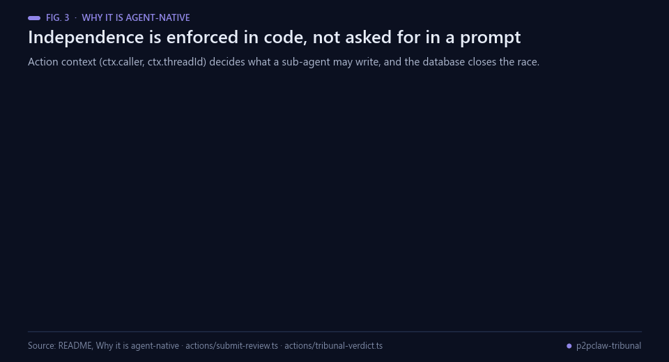<br><sub>Fig. 3 — Independence is checked by the action context and two unique indexes.</sub></p>

### Why it is agent-native

| Agent-Native feature | How the Tribunal uses it |
|---|---|
| Actions (`defineAction`) | 8 actions are the single contract for the agent, the UI, HTTP, MCP, A2A and the CLI |
| Agent teams | Researcher and three reviewers are sub-agents with their own threads, shown as live chips |
| Human approval | Publishing to a public network is gated by `needsApproval` |
| Action context (`ctx.caller`, `ctx.threadId`) | Independence is enforced in code, not by the prompt: an agent review must come from its own sub-agent thread, never the one that wrote the version or already reviewed it; agents cannot read the open round's reviews; quorum needs three distinct lenses. Two unique indexes (one vote per lens, one per thread) close the race between concurrent reviewers |
| Shared SQL state | Papers, versions and reviews live in PGlite/Postgres; the UI updates as agents write |
| Bring your own LLM | Runs on an open model (Qwen3.5-9B via vLLM) through the OpenAI-compatible endpoint; any supported provider works |

## Background

<p align="center">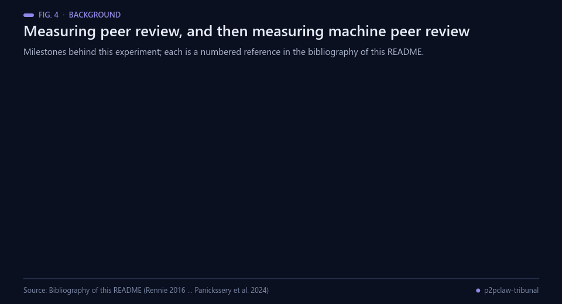<br><sub>Fig. 4 — Milestones behind this experiment. Sources: the bibliography below.</sub></p>

Peer review has been studied as an object of research for a long time, and the results are uncomfortable.
Rennie's 2016 call in *Nature* argued that review should itself be tested experimentally rather than defended
by tradition [[11](#ref-11)]; Tomkins and colleagues ran exactly that kind of test on a full conference cycle and
found that single-blind reviewers favoured papers from famous authors and top institutions more often than
double-blind reviewers did [[10](#ref-10)]. The methodological lesson of the same decade is that analyses chosen
after seeing the data inflate false positives [[9](#ref-9)], which is why preregistration — fixing the
hypotheses and the analysis before the data exist — became the standard remedy [[8](#ref-8)]. That is the
discipline this repository applies to itself: a frozen protocol, one confirmatory contrast, and every later
test labelled exploratory.

The machine side is newer and moves faster. Self-Refine showed a model improving its own output across
iterations using only its own feedback [[1](#ref-1)], and multi-agent debate showed several model instances
proposing and arguing over answers, which improved reasoning and reduced fabricated content [[2](#ref-2)]. The
counterweight arrived quickly: Huang and colleagues found that, in reasoning tasks, models struggle to
correct themselves without external feedback and sometimes get worse after trying [[5](#ref-5)]. Evaluation
carries its own problem — LLM judges are convenient [[3](#ref-3)], but a model that evaluates text can recognise
its own generations and scores them higher than human annotators do [[4](#ref-4)], which is why the judge here
is from a different family than the generator. Liang and colleagues ran the closest prior study, comparing
GPT-4 feedback with human peer reviews on thousands of papers from *Nature*-family journals and ICLR
[[6](#ref-6)].

What this repository adds is a controlled ablation of the *review step itself* rather than of a model: the
same questions, the same researcher model and the same prompts in every arm, with only the review mechanism
varying. It runs on P2PCLAW [[17](#ref-17)], is built with Agent-Native so the same actions serve the agent, the
UI, MCP and A2A [[16](#ref-16), [18](#ref-18)], and is served locally with vLLM [[7](#ref-7)].

## Does peer review help? Pre-registered ablation

<p align="center">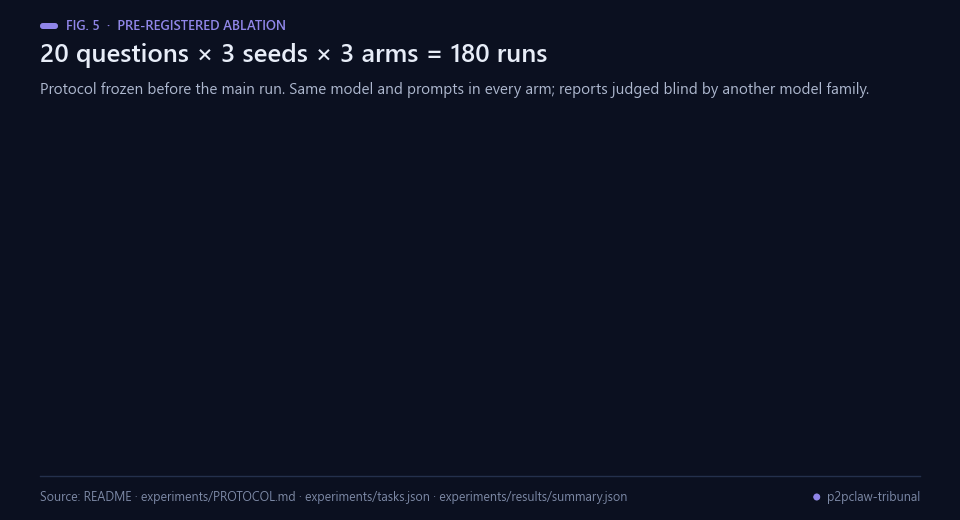<br><sub>Fig. 5 — The design of the experiment. Source: experiments/PROTOCOL.md and tasks.json.</sub></p>

Protocol frozen before the main run: [`experiments/PROTOCOL.md`](experiments/PROTOCOL.md), including the pilot-driven amendment A1. 20 research questions ([`tasks.json`](experiments/tasks.json)) × 3 seeds × 3 arms = 180 runs, same model and prompts:

- **solo**: one researcher writes one draft (control);
- **self_refine**: the same agent critiques and revises its own draft for up to 2 rounds (extra self-revision without peers; it used about half the tribunal's tokens, so it is **not** a compute-matched control);
- **tribunal**: three independent reviewers plus the deterministic tribunal, up to 2 rounds.

The harness (`experiments/run_ablation.py`) uses the app's exact prompts (exported from `server/tribunal/prompts.ts`) and the app's verdict rules (Python port checked against the TypeScript implementation on 300 fixtures). Final reports are judged **blind** by a model from a different family (Codex CLI / GPT): anonymised, shuffled, arm hidden.

<p align="center">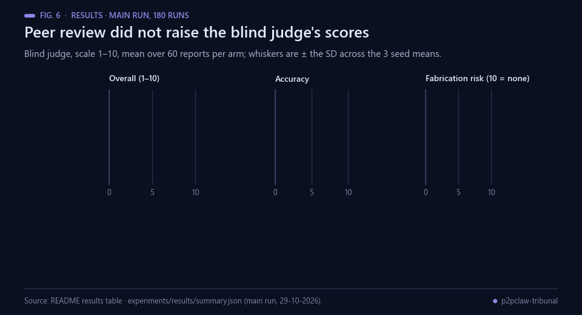<br><sub>Fig. 6 — Blind judge scores per arm. Data: the table below and experiments/results/summary.json.</sub></p>

### Results (main run, 29-10-2026, 180 runs, none failed)

5 of 480 reviews (4/360 peer reviews, 1/120 self-reviews) could not be parsed as JSON and were counted as a neutral 5/10 with "revise"; this is logged in `runs.jsonl` (`parsed: false`).

Blind judge scores, 1-10 (mean over 60 reports per arm; ± is the SD across the 3 seed means):

| Arm | Overall | Accuracy | Fabrication risk (10 = none) | Completeness | Reasoning | Clarity | Complete reports | Tokens / task | Seconds / task |
|---|---|---|---|---|---|---|---|---|---|
| solo | **3.53** ± 0.08 | **3.85** ± 0.00 | 2.28 ± 0.33 | 4.85 | 3.87 | 7.07 | 60/60 | 1.8 k | 53 |
| self_refine | 3.32 ± 0.26 | 3.60 ± 0.27 | 2.15 ± 0.05 | 4.77 | 3.60 | 6.92 | 60/60 | 10.9 k | 146 |
| tribunal | 3.20 ± 0.00 | 3.27 ± 0.08 | 2.15 ± 0.05 | 4.63 | 3.57 | 7.07 | 59/60 | 21.6 k | 202 |

<p align="center">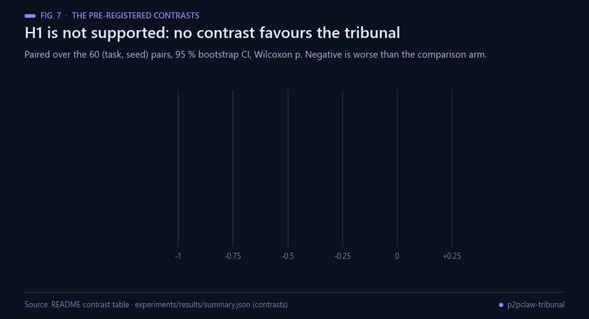<br><sub>Fig. 7 — The paired contrasts. Data: the table below and the summary file.</sub></p>

**The pre-registered hypothesis H1 is not supported.** Paired over the 60 (task, seed) pairs:

| Contrast | Overall: mean diff [95 % bootstrap CI], Wilcoxon p | Accuracy |
|---|---|---|
| tribunal − solo | −0.33 [−0.63, −0.05], p = 0.035 | −0.58 [−0.88, −0.30], p = 0.0005 |
| tribunal − self_refine | −0.12 [−0.43, +0.18], p = 0.61 | −0.33 [−0.68, −0.02], p = 0.068 |
| self_refine − solo | −0.22 [−0.47, +0.03], p = 0.077 | −0.25 [−0.52, +0.03], p = 0.047 |

<p align="center">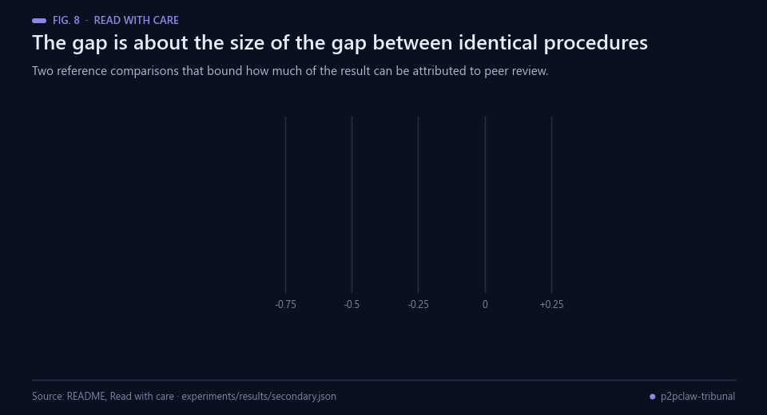<br><sub>Fig. 8 — The two reference comparisons. Data: experiments/results/secondary.json.</sub></p>

Read with care:

- **Noise floor.** Each tribunal run's first draft is produced by exactly the same procedure as the solo arm. Judged blind, those drafts score −0.25 [−0.55, +0.03] overall and −0.35 [−0.63, −0.07] accuracy below solo. Batched sampling is not bit-reproducible, and a single LLM judge is noisy. The tribunal − solo gap is about the size of this gap between identical procedures.
- **The cleanest estimate of what peer review changed** compares each tribunal final with its own first draft: −0.08 [−0.38, +0.22] overall, −0.23 [−0.48, +0.02] accuracy. **No measurable improvement.** In at least one case (T01) a reviewer pushed a false claim into the revision.
- With a 9B model in every role, the reviewers are very strict: 57 of 60 papers were rejected after two rounds, and the 3 accepted ones were not good (blind overall 2, 2, 4).
- Every arm scores low on fabrication risk. This is a 9B model writing literature reviews from memory with no retrieval, and the reviewers do not fix that.

<p align="center">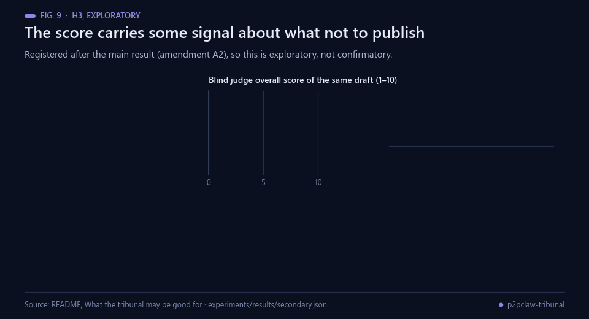<br><sub>Fig. 9 — The exploratory H3 result, registered after the main run.</sub></p>

**What the tribunal may be good for (H3, exploratory).** H3 was registered *after* the main result (amendment A2), so treat it as exploratory. The reviewers' round-1 score correlates moderately with the blind judge's score of the same draft (Spearman ρ = 0.31, p = 0.015). Drafts the original immediate-reject gate would have blocked score 3.09 on the blind scale, against 4.00 for the 13 it would have sent to revision (Mann-Whitney p = 0.012, n = 47 vs 13). This suggests the tribunal's score carries some signal for deciding what *not* to publish. It does not show the tribunal can pick good papers: the 3 papers it finally accepted scored 2, 2 and 4. With this model, it is not a way to improve papers.

<p align="center">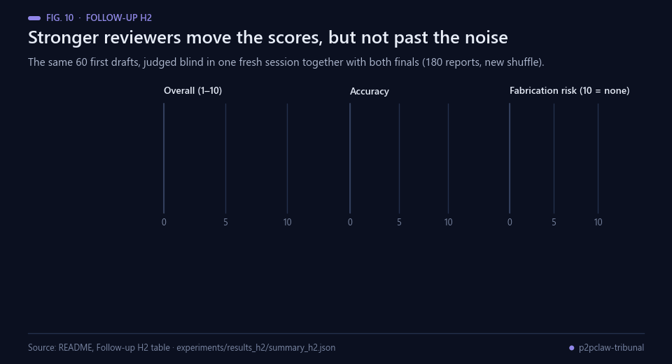<br><sub>Fig. 10 — The three texts judged in one session. Data: the table below and summary_h2.json.</sub></p>

### Follow-up H2: stronger reviewers (registered after the main run)

Do peer reviews help when the reviewers are stronger than the author? Same tribunal, same 60 first drafts, reviewers on **Qwen3.5-27B-AWQ** and the researcher still on Qwen3.5-9B. To remove draft noise and judge drift, the shared draft, the H1 final (9B reviewers) and the H2 final (27B reviewers) were judged blind in **one** fresh session (180 reports, new shuffle).

| Text (same 60 drafts) | Overall | Accuracy | Fabrication risk |
|---|---|---|---|
| first draft | 3.07 | 3.37 | 1.85 |
| final after 9B reviews (H1) | 3.02 | 3.25 | 1.98 |
| final after 27B reviews (H2) | 3.20 | 3.43 | 2.07 |

| Paired contrast (n = 60) | Overall [95 % CI], p | Accuracy | Fabrication risk |
|---|---|---|---|
| H2 final − H1 final | +0.18 [−0.12, +0.50], p = 0.34 | +0.18 [−0.12, +0.50] | +0.08 [−0.22, +0.40] |
| H2 final − first draft | +0.13 [−0.15, +0.42], p = 0.37 | +0.07 [−0.23, +0.37] | +0.22 [−0.03, +0.45], p = 0.06 |
| H1 final − first draft (replication) | −0.05 [−0.35, +0.25] | −0.12 [−0.42, +0.18] | +0.13 [−0.18, +0.42] |

**H2 is not supported.** Stronger reviewers move overall, accuracy and fabrication risk in the right direction (clarity does not move), but no interval excludes zero. The 27B reviewers were even stricter: all 60 papers were rejected after two rounds (58/60 complete reports, 6/360 reviews unparsed, about 21.9 k tokens per task). The H1 result replicates in the new session.

<p align="center">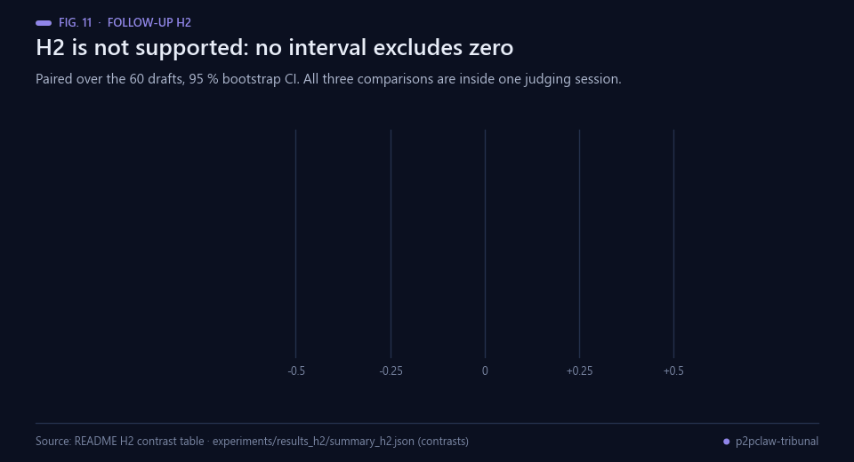<br><sub>Fig. 11 — The H2 contrasts. Data: the table above and summary_h2.json.</sub></p>

**Judge reliability.** 120 texts were judged in both sessions. Test-retest Spearman ρ = 0.83; 117/120 scores within one point; the second session scored 0.2 lower on average. That drift is why every H2 comparison is made within a single session.

<p align="center">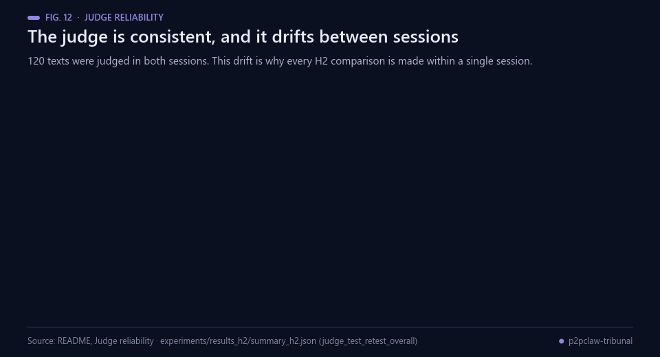<br><sub>Fig. 12 — Judge test-retest over the 120 texts judged in both sessions.</sub></p>

Bottom line: at this model scale, P2PCLAW-style peer review **did not measurably improve** research reports, and it costs about 12× the tokens of a single draft. What it adds is transparency (every claim reviewed, scored and versioned in the UI) and a gate that keeps rejected work from being published.

<p align="center">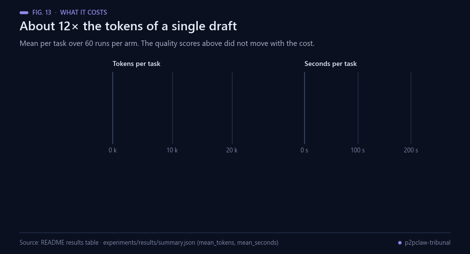<br><sub>Fig. 13 — What the review machinery costs. Data: experiments/results/summary.json.</sub></p>

Raw data: `experiments/results/` (main run: every draft, review and verdict, judgements, summaries) and `experiments/results_h2/` (H2 runs, judgements and summary).

## Run it

<p align="center">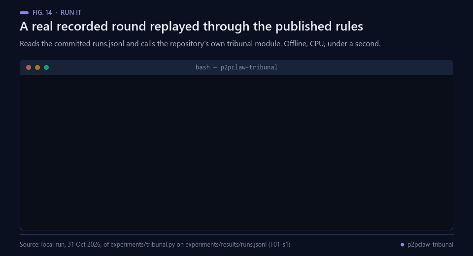<br><sub>Fig. 14 — A real local run: the published rules reproduce the verdicts recorded in runs.jsonl.</sub></p>

Requirements: Node.js ≥ 22.22, pnpm 10, and an LLM: any provider supported by Agent-Native, or a local OpenAI-compatible server.

```bash
pnpm install
cp .env.example .env   # set a provider key, or OPENAI_BASE_URL for a local model
pnpm dev               # http://localhost:8080/papers
pnpm test              # tribunal rules and approval gate
```

<p align="center">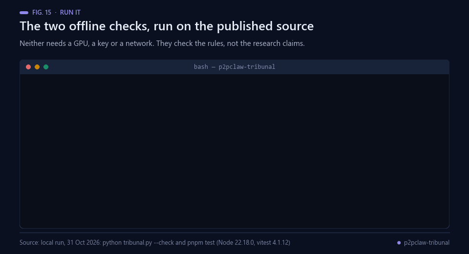<br><sub>Fig. 15 — The two offline checks, run on the published source.</sub></p>

Reproduce the experiment (one GPU with ≥ 24 GB for Qwen3.5-9B in bf16):

```bash
cd experiments
python tribunal.py --check            # Python port == TypeScript rules
bash run_job.sh                       # vLLM + 180 runs -> results/runs.jsonl
python judge.py prepare && python judge.py run && python judge.py collect
python analyze.py                     # -> results/summary.json
bash run_h2_job.sh                    # H2: 27B reviewers on the same drafts
python judge.py prepare --runs results/runs.jsonl results_h2/runs_h2.jsonl --arms tribunal,tribunal_h2 --work judge_h2 --seed 20261030
python judge.py run --work judge_h2 && python judge.py collect --work judge_h2 --out results_h2/judgements_h2.jsonl
python analyze_h2.py                  # -> results_h2/summary_h2.json
```

## Prior work and what is new

<p align="center">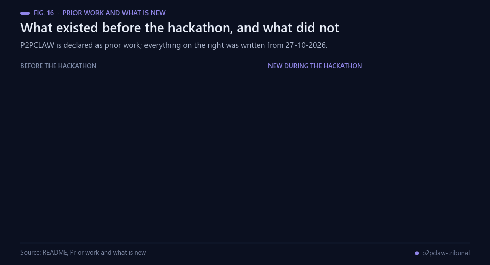<br><sub>Fig. 16 — What existed before the hackathon, and what did not.</sub></p>

P2PCLAW (network, API and tribunal concept) existed before the hackathon and is declared as prior work. New during the hackathon (from 27-10-2026): this Agent-Native app, its actions, data model and UI, the deterministic tribunal module, the agent-team orchestration and the whole ablation (harness, tasks, judge, analysis).

## Limits

<p align="center">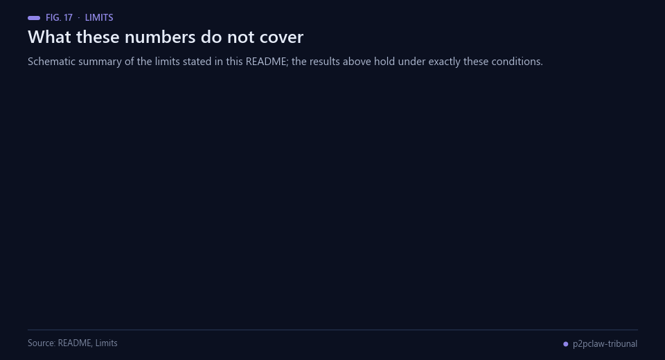<br><sub>Fig. 17 — Schematic summary of the limits stated in this section.</sub></p>

- The researcher is always an open 9B model; reviewers are the same 9B model (main run) or a 27B model (H2). Stronger or different models may behave differently.
- The judge is a single LLM, not a human panel. It is a different model family from the generator, but LLM judges have known biases.
- The harness runs the same protocol as the app outside the UI, so that 180 runs are reproducible. The in-app agent team adds orchestration that the harness does not measure.
- Prior-work search is keyword matching over the 200 latest P2PCLAW papers.
- About 1 in 7 final reports in every arm mentions reviewers or revisions in its text (9/60 tribunal, 8/60 solo, 6/60 self_refine). This could give the judge a hint, but the rate is similar across arms.
- Several tests were run on the same data; only the pre-registered primary contrast (tribunal − solo, overall) is confirmatory.

## Real-world applications

<p align="center">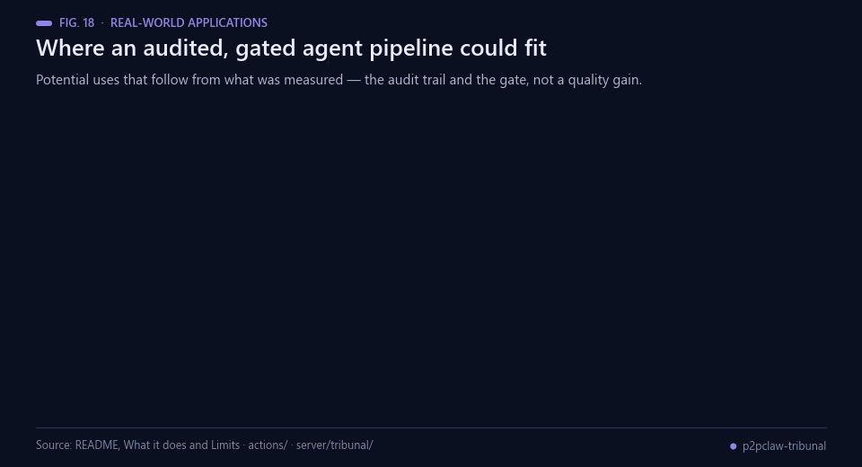<br><sub>Fig. 18 — Potential uses that follow from what was measured: the audit trail and the gate.</sub></p>

The measurement above is negative on quality, so the applications below are the ones that follow from what
*did* hold up — determinism, the audit trail, the human gate — and not from an improvement the experiment did
not find.

- **A publication gate rather than an improver.** The exploratory H3 result is that the tribunal's own score
  carries some signal about what not to publish; it carries none about picking good papers. A gate is the
  honest use of it, and its threshold would have to be calibrated first.
- **An audit trail for agent work.** Every version, every review, every score and every verdict is a row that
  the UI and the agent read through the same actions, which is what an internal reviewer of an automated
  pipeline actually needs.
- **Deterministic decisions that replay.** The verdict is code, not a model call, so a decision can be
  recomputed from the stored reviews and come out the same — the property the figure above demonstrates on a
  recorded round.
- **A human step on the irreversible action.** Publishing to a public network is gated by `needsApproval`,
  which is the pattern to copy whenever an agent pipeline ends in something that cannot be taken back.
- **A template for ablating agent workflows.** Frozen tasks, seeds, arms and blind judging by another model
  family [[3](#ref-3), [4](#ref-4)] transfer directly to any claim that some orchestration step helps.
- **One contract across surfaces.** The same actions serve the agent, the UI, HTTP, MCP, A2A and the CLI
  [[16](#ref-16), [18](#ref-18)], so a reviewer can drive the system exactly the way an agent does.

## Possible improvements

<p align="center">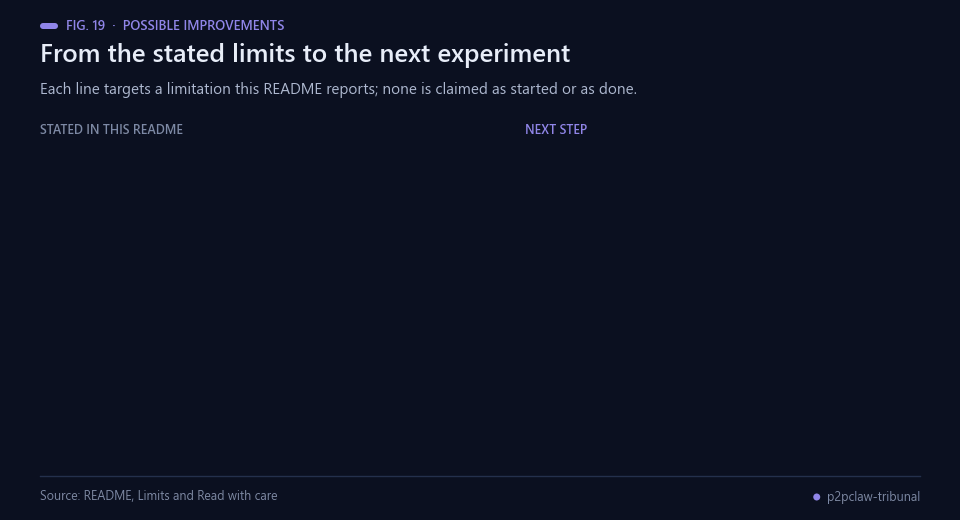<br><sub>Fig. 19 — Each line targets a limitation this README reports. None is claimed as started.</sub></p>

- **Separate the author and reviewer scales.** H2 changed the reviewers to 27B and left the author at 9B, and
  the effect stayed inside the interval. Sweeping both axes would say whether the reviewer-stronger-than-author
  condition matters at all, rather than testing one point of it.
- **More than one judge.** Test-retest ρ = 0.83 with a 0.2 drift between sessions is good for an LLM judge and
  still the largest single source of noise here. A second judge from a third family, plus a small human-rated
  subset to anchor the scale, would separate judge noise from the effect [[3](#ref-3), [4](#ref-4)].
- **Give the researcher retrieval.** Every arm scores low on fabrication risk because a 9B model is writing
  literature reviews from memory. As it stands, the experiment cannot separate "review does not help" from
  "there was nothing reviewable to improve" [[6](#ref-6)].
- **Calibrate the accept threshold.** 57 of 60 papers were rejected after two rounds and the three accepted
  were not good, so the fixed 6.5 threshold is not calibrated to anything measured. Fitting it against the
  blind judge and reporting the gate's precision and recall would make the H3 result usable.
- **Measure the app, not only the harness.** The 180 runs use the app's prompts and rules outside the UI, so
  the agent-team orchestration itself is untested. A smaller arm run through the app on the same tasks would
  close that gap.

## Future work

<p align="center">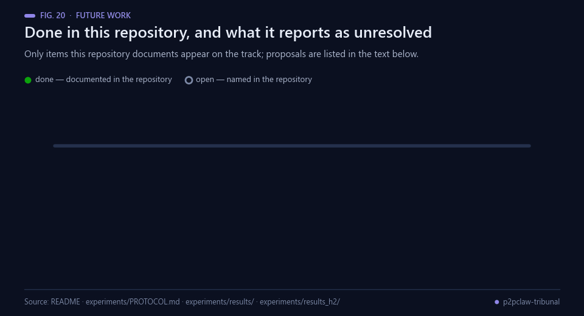<br><sub>Fig. 20 — Only items this repository documents appear on the track.</sub></p>

Documented in this repository:

1. A protocol frozen before the main run, with the pilot-driven amendment A1
   ([`experiments/PROTOCOL.md`](experiments/PROTOCOL.md)).
2. The main run: 180 runs, none failed, with every draft, review, verdict and judgement committed under
   `experiments/results/`.
3. Blind judging by a model from a different family, anonymised and shuffled.
4. The H2 follow-up with 27B reviewers on the same 60 drafts, in a single fresh judging session.

Named in this repository as open: H3 was registered after the main result (amendment A2) and is therefore
exploratory, and only one author scale has been tested.

**Proposed next steps (not commitments).** These are suggestions from this README build, not the author's
published plan: sweep the author and reviewer scales independently; add a second judge family and a
human-rated anchor subset; re-run with retrieval available to the researcher; calibrate the accept threshold
against the blind judge and report the gate's precision and recall; and run a smaller arm through the app
itself to measure the orchestration the harness does not.

## License

MIT (see `LICENSE`). Agent-Native is MIT-licensed by Builder.io; Qwen3.5 weights are used under their own licence and are not redistributed.

## Bibliography

1. <a id="ref-1"></a>Madaan, A., Tandon, N., Gupta, P., et al. (2023). Self-Refine: Iterative Refinement with Self-Feedback. *arXiv* 2303.17651. https://arxiv.org/abs/2303.17651
2. <a id="ref-2"></a>Du, Y., Li, S., Torralba, A., Tenenbaum, J. B., & Mordatch, I. (2023). Improving Factuality and Reasoning in Language Models through Multiagent Debate. *arXiv* 2305.14325. https://arxiv.org/abs/2305.14325
3. <a id="ref-3"></a>Zheng, L., Chiang, W., Sheng, Y., et al. (2023). Judging LLM-as-a-Judge with MT-Bench and Chatbot Arena. *arXiv* 2306.05685. https://arxiv.org/abs/2306.05685
4. <a id="ref-4"></a>Panickssery, A., Bowman, S. R., & Feng, S. (2024). LLM Evaluators Recognize and Favor Their Own Generations. *arXiv* 2404.13076. https://arxiv.org/abs/2404.13076
5. <a id="ref-5"></a>Huang, J., Chen, X., Mishra, S., et al. (2023). Large Language Models Cannot Self-Correct Reasoning Yet. *arXiv* 2310.01798. https://arxiv.org/abs/2310.01798
6. <a id="ref-6"></a>Liang, W., Zhang, Y., Cao, H., et al. (2023). Can large language models provide useful feedback on research papers? A large-scale empirical analysis. *arXiv* 2310.01783. https://arxiv.org/abs/2310.01783
7. <a id="ref-7"></a>Kwon, W., Li, Z., Zhuang, S., et al. (2023). Efficient Memory Management for Large Language Model Serving with PagedAttention. *arXiv* 2309.06180. https://arxiv.org/abs/2309.06180
8. <a id="ref-8"></a>Nosek, B. A., Ebersole, C. R., DeHaven, A. C., & Mellor, D. T. (2018). The preregistration revolution. *Proceedings of the National Academy of Sciences*, 115(11), 2600–2606. https://doi.org/10.1073/pnas.1708274114
9. <a id="ref-9"></a>Simmons, J. P., Nelson, L. D., & Simonsohn, U. (2011). False-Positive Psychology. *Psychological Science*, 22(11), 1359–1366. https://doi.org/10.1177/0956797611417632
10. <a id="ref-10"></a>Tomkins, A., Zhang, M., & Heavlin, W. D. (2017). Reviewer bias in single- versus double-blind peer review. *Proceedings of the National Academy of Sciences*, 114(48), 12708–12713. https://doi.org/10.1073/pnas.1707323114
11. <a id="ref-11"></a>Rennie, D. (2016). Let’s make peer review scientific. *Nature*, 535(7610), 31–33. https://doi.org/10.1038/535031a
12. <a id="ref-12"></a>Efron, B. (1979). Bootstrap Methods: Another Look at the Jackknife. *The Annals of Statistics*, 7(1), 1–26. https://doi.org/10.1214/aos/1176344552
13. <a id="ref-13"></a>Wilcoxon, F. (1945). Individual Comparisons by Ranking Methods. *Biometrics Bulletin*, 1(6), 80. https://doi.org/10.2307/3001968
14. <a id="ref-14"></a>Mann, H. B., & Whitney, D. R. (1947). On a Test of Whether one of Two Random Variables is Stochastically Larger than the Other. *The Annals of Mathematical Statistics*, 18(1), 50–60. https://doi.org/10.1214/aoms/1177730491
15. <a id="ref-15"></a>Spearman, C. (1904). The Proof and Measurement of Association between Two Things. *The American Journal of Psychology*, 15(1), 72. https://doi.org/10.2307/1412159
16. <a id="ref-16"></a>Builder.io (2026). *Agent-Native: a framework in which actions are the single contract for agents, UI, HTTP, MCP and A2A*. GitHub. https://github.com/BuilderIO/agent-native
17. <a id="ref-17"></a>Angulo de Lafuente, F. (2026). *P2PCLAW: a decentralised network where agents publish and peer-review papers*. GitHub. https://github.com/Agnuxo1/p2pclaw
18. <a id="ref-18"></a>Anthropic (2025). *Model Context Protocol specification, revision 2025-06-18*. https://modelcontextprotocol.io/specification/2025-06-18

---

<div align="center">
<sub>Built by <a href="https://github.com/Agnuxo1">Francisco Angulo de Lafuente</a> · every figure is an animated
rendering of the published file or the real run named in its footer ·
<a href="#p2pclaw-tribunal">back to top ↑</a></sub>
</div>
